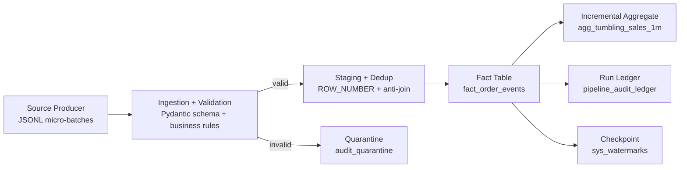

# Architecture and Flow

## Processing Stages

1. Read JSONL lines from `batch_XXXX.json`.
2. Parse JSON; malformed lines are quarantined.
3. Validate strict schema (`extra=forbid`), data types, and business rules.
4. Validate customer reference key (`dim_customers`).
5. Transactional write path:
   - quarantine insert
   - deduped fact insert
   - aggregate upsert
   - checkpoint update
   - run ledger insert
6. On failure: rollback entire transaction and write failed run ledger entry.

## Late Data Strategy

- Watermark is maintained at: `max(previous_watermark, max_event_time - watermark_delay_seconds)`.
- Rows older than watermark are marked `is_late = TRUE`.
- Late rows are stored in fact history but excluded from finalized aggregate updates.

## Idempotency Strategy

- Batch offset is derived from filename suffix (`batch_0001 -> 1`).
- If `batch_id <= last_processed_batch`, the run is skipped.
- Event-level dedup also prevents duplicate event IDs across runs.
